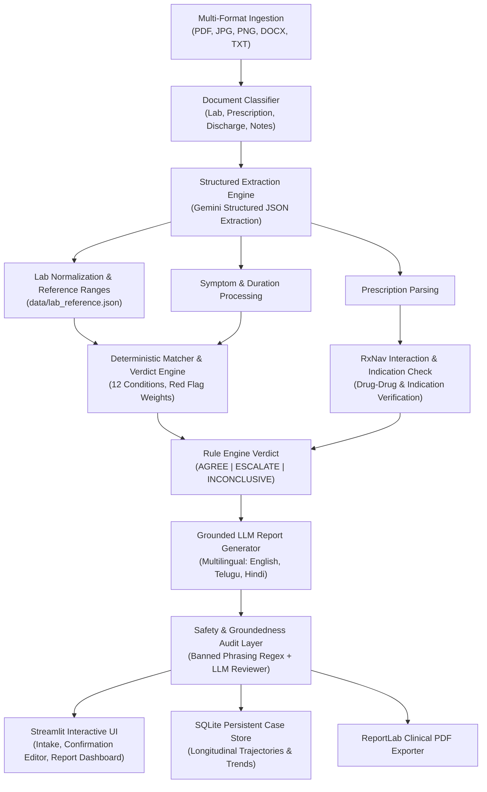

# HealthAi — Second-Opinion Companion

[](https://www.python.org/)
[]()
[](LICENSE)

> **AI-powered clinical second-opinion assessment companion for grounded, evidence-based health insights.**

🔗 **[Launch HealthAi](http://localhost:8501/)**

An evidence-based clinical second-opinion assessment companion designed to empower patients with grounded health insights without replacing healthcare professionals or prescribing medical therapy.

HealthAi ingests patient symptoms, doctor diagnoses, diagnostic laboratory reports, and prescription documents to compute an objective verdict (**`AGREE`**, **`ESCALATE`**, or **`INCONCLUSIVE`**) paired with deterministic urgency ratings (**`routine`**, **`same_day`**, or **`emergency`**).

---

## 🩺 Mandatory Medical Notice

> **This tool provides general health information and is not a medical diagnosis. It cannot replace a qualified doctor. Please confirm any findings with a specialist, and seek urgent care for severe or worsening symptoms.**

**Telugu:**

> ఈ సాధనం సాధారణ ఆరోగ్య సమాచారాన్ని అందిస్తుంది మరియు ఇది వైద్య నిర్ధారణ కాదు. ఇది అర్హత కలిగిన వైద్యుడిని భర్తీ చేయదు. దయచేసి నిపుణుడితో ధృవీకరించుకోండి మరియు తీవ్రమైన లేదా విషమించే లక్షణాల కోసం అత్యవసర సంరక్షణను పొందండి.

**Hindi:**

> यह उपकरण सामान्य स्वास्थ्य जानकारी प्रदान करता है और यह कोई चिकित्सीय निदान नहीं है। यह किसी योग्य चिकित्सक का स्थान नहीं ले सकता। कृपया किसी विशेषज्ञ से किसी भी निष्कर्ष की पुष्टि करें, और गंभीर या बिगड़ते लक्षणों के लिए तत्काल आपातकालीन चिकित्सा सहायता लें।

---

## 🏛️ System Architecture

PulseAi utilizes a **deterministic-first, grounded-LLM pipeline** where all clinical decisions, urgency categorizations, and red-flag scoring are computed deterministically before any natural language generation occurs.



---

## 🛡️ Clinical Safety Invariants (SPEC Section 3)

The architecture strictly adheres to non-negotiable safety rules in every file and output stream:

1. **No Direct Diagnosing:** Never asserts *"You have [Condition]"*. Instead uses calibrated language: *"Your findings may be consistent with..."* or *"associated with..."*.
2. **No Medication Tampering:** Never advises users to discontinue, alter, or start any medication or dose. All drug considerations are framed as *"Points to discuss with your doctor or pharmacist"*.
3. **No Unprescribed Dosages:** PulseAi never calculates or suggests prescription medication dosages.
4. **Physician Respect:** Never states *"Your doctor is wrong"*. Formulates observations as *"Some findings are not fully explained by the current diagnosis"*.
5. **Verbatim Disclaimer Guarantee:** Every report, UI view, and PDF export includes the mandatory disclaimer in the user's chosen language.
6. **Deterministic Urgency:** Urgency levels (`routine`, `same_day`, `emergency`) are strictly computed by deterministic rule thresholds, never inferred by open-ended generation.
7. **Secondary Groundedness Review:** All report payloads undergo secondary validation to eliminate ungrounded claims or hallucinated lab values.

---

## 🚀 Quickstart & Setup Guide

### 1. Prerequisites

* Python 3.10, 3.11, 3.12, or 3.14
* Git

### 2. Clone and Setup Environment

```bash
# Clone the repository
git clone https://github.com/your-username/health_companion.git
cd health_companion

# Create a virtual environment
python -m venv .venv

# Activate the virtual environment
# Windows (PowerShell):
.venv\Scripts\Activate.ps1

# macOS / Linux:
source .venv/bin/activate
```

### 3. Install Dependencies

```bash
pip install -r requirements.txt
```

### 4. Configure API Keys

Copy the example environment template:

```bash
copy .env.example .env     # Windows
cp .env.example .env       # Linux / macOS
```

Edit `.env` and provide your Google Gemini API key:

```env
GEMINI_API_KEY=your_gemini_api_key_here
```

> **Note:** If no API key is provided, the application automatically engages its deterministic offline fallbacks for testing and grading.

### 5. Run the Test Suite

Run the comprehensive 66-test verification suite:

```bash
python -m pytest tests/ -v
```

### 6. Launch the Application

```bash
streamlit run app.py
```

The application will launch in your default browser at:

```text
http://localhost:8501
```

---

## 🧪 Demo Cases & Clinical Walkthrough

HealthAi includes one-click pre-configured demo cases in the sidebar:

### 🔹 Case 1: Viral Upper Respiratory Infection (AGREE)

* **Patient:** 28 Female | Symptoms: Runny nose, mild fever, sore throat (2 days).
* **Doctor's Diagnosis:** "Viral upper respiratory infection".
* **Prescription:** Paracetamol 500mg, rest, hydration.
* **Outcome:** **`AGREE`** (Routine urgency). Reinforces supportive care, lists warning signs to monitor.

### 🔹 Case 2: Prolonged Cough / Tuberculosis Suspect (ESCALATE)

* **Patient:** 34 Male | Symptoms: Cough for 3 weeks, evening fever, night chills, weight loss.
* **Doctor's Diagnosis:** "Regular infection" | Prescription: Azithromycin.
* **Laboratory Report:** ESR 65 mm/hr (Elevated inflammatory marker).
* **Outcome:** **`ESCALATE`** (Same-Day / Soon). Flags tuberculosis red-flag pattern, highlights that cough duration and elevated ESR exceed a simple infection, recommends consult with a **Pulmonologist** and confirmatory tests (Chest X-Ray, Sputum CBNAAT).

### 🔹 Case 3: Fatigue & Polydipsia / Diabetes Suspect (ESCALATE)

* **Patient:** 45 Male | Symptoms: Chronic fatigue, excessive thirst, frequent urination (6 weeks).
* **Doctor's Diagnosis:** "Weakness, vitamin deficiency" | Prescription: Multivitamins.
* **Laboratory Report:** Fasting Blood Sugar 138 mg/dL (Elevated > 99 mg/dL).
* **Outcome:** **`ESCALATE`** (Same-Day / Soon). Flags diabetic symptomatology with impaired fasting glucose, recommends evaluation by an **Endocrinologist** and confirmatory tests (HbA1c, Post-Prandial Glucose).

### 🔹 Case 4: Longitudinal Follow-up (NOT_IMPROVING & Treatment Review)

* Patient returns on Day 5 after initial Case 1 visit: *"Fever persists, now developing ear pain and worsening throat discomfort"*.
* **Outcome:** Case trajectory updates to **`NOT_IMPROVING`**, flags treatment review need, recommends doctor visit within 24 hours.

### 🔹 Case 4b: Emergency Red-Flag Trigger (URGENT)

* Patient reports: *"Severe chest pain and sudden shortness of breath"*.
* **Outcome:** Short-circuits regular chat to render an immediate **Emergency Care Notice** prompting immediate ER or 911/108 response.

---

## 🌐 Multilingual Capabilities

HealthAi supports real-time localized assessment in:

* **English (US)**
* **Telugu (తెలుగు)**
* **Hindi (हिन्दी)**

Clinical terms retain standardized English descriptors alongside script transliterations (e.g. `మలేరియా (Malaria)` / `मलेरिया (Malaria)`), ensuring medical accuracy while remaining accessible to diverse patient communities.

---

## ⚠️ Known Limitations & Clinical Disclosures (SPEC Section 7)

* **Not a Diagnostic Tool:** Second-Opinion Companion provides evidence matching and second-opinion decision support; it never makes definitive diagnostic claims.
* **Data Quality Sensitivity:** Assessment reliability depends entirely on the completeness and accuracy of user-provided symptoms, doctor records, and lab values.
* **Target Condition Coverage:** The deterministic matcher directly evaluates 12 high-prevalence conditions; uncommon conditions receive conservative, generalized recommendations.
* **No Direct Imaging Interpretation:** The system reads textual radiology reports, but cannot interpret raw radiological DICOM imaging (CT/MRI/X-Ray) or histology slides.
* **OCR Verification:** Text extraction from blurry photos may experience OCR errors. Users are prompted to verify and edit extracted data before report generation.
* **Clinical Review Requirement:** Knowledge base heuristics (`core/knowledge.py`) and laboratory thresholds require institutional medical faculty review before real-world patient deployment.

---

## 📂 Repository Structure

```text
health_companion/
├── app.py                      # Main Streamlit application (Intake, Confirm, Result)
├── core/
│   ├── drugcheck.py            # RxNav API & prescription safety checks
│   ├── extract.py              # Structured extraction (symptoms, labs, drugs)
│   ├── followup.py             # Longitudinal case follow-up & trajectory engine
│   ├── ingest.py               # Multi-format ingestion (PDF, DOCX, TXT, OCR)
│   ├── knowledge.py             # 12 conditions, red flag weights, specialists
│   ├── labs.py                 # Laboratory test normalization & reference ranges
│   ├── llm.py                  # Resilient Gemini LLM API client wrapper
│   ├── matcher.py              # Deterministic signal extraction & verdict engine
│   ├── pdf_export.py           # ReportLab clinical PDF generation
│   ├── pipeline.py             # End-to-end clinical verification pipeline
│   ├── safety.py               # Section 3 safety filters & localized disclaimers
│   ├── storage.py              # SQLite case, event, and message storage
│   └── trends.py               # Longitudinal lab trends & Plotly visualization
├── data/
│   ├── lab_reference.json      # Standard reference ranges and critical limits
│   └── synonyms.json           # Diagnostic terminology mapping dictionaries
├── samples/                    # Fixture cases (Viral, TB, Diabetes)
├── tests/                      # 66 comprehensive pytest test suites
├── ui_template/
│   └── style.css               # PulseAi modern clinical styling
├── requirements.txt            # Python dependencies
└── SPEC.md                     # Specification requirements & rules
```
